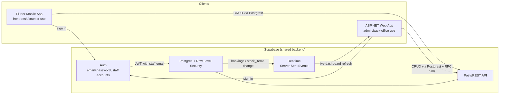

# Activity 3.1 — System Architecture

Draft owner: Ofentse Rammutla (turn this into a proper diagram-tool export).
Source of truth: `web/CLAUDE.md`, `supabase/migrations/`, and the live app.

## Main components

| Component | Purpose | Talks to |
|---|---|---|
| **Flutter mobile app** (`/mobile`) | Field/counter use — booking capture, stock, invoices, on a phone/tablet | Supabase directly (no custom API layer) |
| **ASP.NET web app** (`/web`) | Front-desk/admin use — same data, plus admin-only actions (finalize, delete, reopen) | Supabase directly, via the `Supabase` NuGet client |
| **Supabase backend** | Shared Postgres database, Auth, Row Level Security, Realtime, REST (Postgrest) | Single source of truth for both apps |

There is **no separate custom backend API** — both client apps talk to
Supabase directly over Postgrest/Auth/Realtime, with Row Level Security
policies as the access-control layer instead of server-side business logic
in a middle tier. That's a deliberate, in-scope architectural choice for a
prototype of this size, and worth stating explicitly in the write-up.

## Diagram (Mermaid — paste into draw.io/Lucid/Figma, or keep as-is for GitHub rendering)

## Data flows worth calling out

1. **Booking created on mobile -> visible on web immediately** (and vice
   versa) — both apps read/write the same `bookings` table; only the web
   dashboard currently has a Realtime subscription (mobile doesn't — see
   `web/README.md`'s M7 note, a known gap, not a bug).
2. **Stock is decremented atomically** when a part is linked to a booking —
   done inside a single Postgres function (`add_booking_part`), not as
   separate client-side calls, so a partial failure can't silently lose
   stock. See `supabase/migrations/0004_atomic_stock_decrement.sql`.
3. **Admin vs staff is enforced twice** — hidden in the UI (both apps) *and*
   rejected server-side on web if someone posts the handler directly
   (`web/Auth/AdminAccess.cs`). Mobile doesn't have this distinction yet —
   flag as a design gap to raise with Ms Mbele or fix before the demo.
4. **Auth is Supabase's own** (JWT-based), not a custom login system — RLS
   policies key off the authenticated user, not a separate roles table.
5. **New 22 Sept, not yet built**: a customer-facing repair-status lookup
   is a confirmed requirement (see `uml-and-erd.md`'s "New feature"
   section) — the first genuinely **unauthenticated** route in the system.
   Everything above sits behind Supabase Auth; this one screen
   deliberately doesn't, so it needs its own RLS read policy scoped to
   "anyone who has the reference code," not "anyone signed in." Which app
   hosts it (web page vs. a mobile screen) and what the reference code
   actually is are both still open — see `uml-and-erd.md`.

## Confirm before finalizing (per the Unit 3 checklist)

- [ ] Flutter mobile application is shown
- [ ] ASP.NET web application is shown
- [ ] Supabase is shown as the shared backend
- [ ] relevant users/actors are identified (see `uml-and-erd.md`)
- [ ] important connections and data flows are shown
- [ ] the diagram reads as **one integrated system**, not two separate apps
