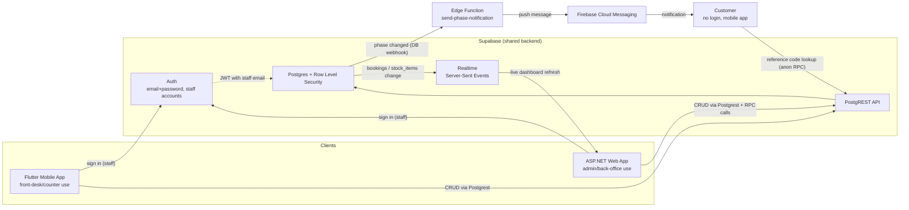

# Activity 3.1 — System Architecture

Draft owner: Ofentse Rammutla (turn this into a proper diagram-tool export).
Source of truth: `web/CLAUDE.md`, `supabase/migrations/`, and the live app.

## Main components

| Component | Purpose | Talks to |
|---|---|---|
| **Flutter mobile app** (`/mobile`) | Field/counter use — booking capture, stock, invoices, on a phone/tablet | Supabase directly (no custom API layer) |
| **ASP.NET web app** (`/web`) | Front-desk/admin use — same data, plus admin-only actions (finalize, delete, reopen) | Supabase directly, via the `Supabase` NuGet client |
| **Supabase backend** | Shared Postgres database, Auth, Row Level Security, Realtime, REST (Postgrest), database functions (RPC) | Single source of truth for both apps |
| **Supabase Edge Function** `send-phase-notification` (`mobile/supabase/functions`) | Called by a Database Webhook when a booking's `phase` changes; sends the push message | Postgres (service role), Firebase |
| **Firebase Cloud Messaging** | Delivers phase-change push notifications to the customer's phone | Edge Function (sender), customer's mobile app (receiver) |

There is **no separate custom backend API** (the one Edge Function only
sends notifications) — both client apps talk to Supabase directly over Postgrest/Auth/Realtime, with Row Level Security
policies as the access-control layer instead of server-side business logic
in a middle tier. That's a deliberate, in-scope architectural choice for a
prototype of this size, and worth stating explicitly in the write-up.

## Diagram (Mermaid — paste into draw.io/Lucid/Figma, or keep as-is for GitHub rendering)

## Data flows worth calling out

1. **Booking created on mobile -> visible on web immediately** (and vice
   versa) — both apps read/write the same `bookings` table; only the web
   dashboard currently has a Realtime subscription (mobile doesn't — see
   `web/README.md`'s M7 note, a known gap, not a bug).
2. **Stock is decremented atomically** when a part is linked to a booking —
   done inside a single Postgres function (`add_booking_part`), not as
   separate client-side calls, so a partial failure can't silently lose
   stock. See `supabase/migrations/0004_atomic_stock_decrement.sql`.
3. **Admin vs mechanic** — only Admin can finalize, delete, reopen and remove
   parts/labour (agreed 23 Sept). Web: hidden in the UI and rejected
   server-side (`web/Auth/AdminAccess.cs`, `AdminEmails` allowlist). Mobile
   (28 Sept): hidden in the UI based on the signed-in user's `profiles.role`.
   Delete is also refused inside the database for non-admins (migration 0007).
   Known gap: two sources of truth for "who is admin" (web allowlist vs
   `profiles`) — keep them in step.
4. **Auth is Supabase's own** (JWT-based) on both apps (mobile since 28
   Sept; before that it had only a role picker). Mobile reads the role from a
   `profiles` table (one row per staff user).
5. **Customer lookup (built on mobile, 28 Sept)** — the only
   **unauthenticated** path in the system. The customer enters a random
   8-character `reference_code` and the app calls
   `get_booking_by_reference_code`, a `security definer` database function
   that returns only that booking's phase, parts and labour. Anonymous users
   get no direct read access to any table.
6. **Phase notifications (built 28 Sept)** — staff move a booking through
   five phases; a Database Webhook calls the Edge Function, which sends a
   Firebase push to every phone registered for that booking
   (`booking_push_tokens`, via `register_push_token`). Web Finalize/Reopen
   set the phase too, so the customer always sees the right stage.
   **Scope note:** Phase 1 excluded push-based customer tracking; this is a
   scope change and must be recorded in the SRS Requirements Change Log.

## Confirm before finalizing (per the Unit 3 checklist)

- [ ] Flutter mobile application is shown
- [ ] ASP.NET web application is shown
- [ ] Supabase is shown as the shared backend
- [ ] relevant users/actors are identified (see `uml-and-erd.md`)
- [ ] important connections and data flows are shown
- [ ] the diagram reads as **one integrated system**, not two separate apps
