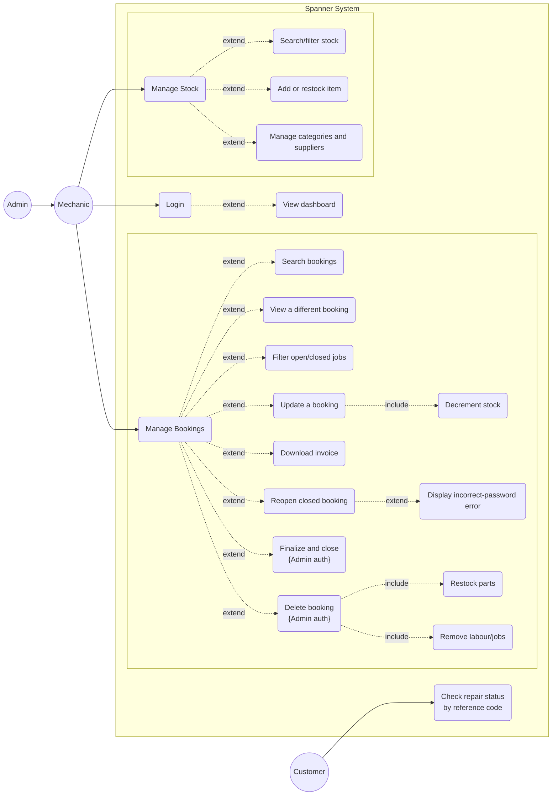
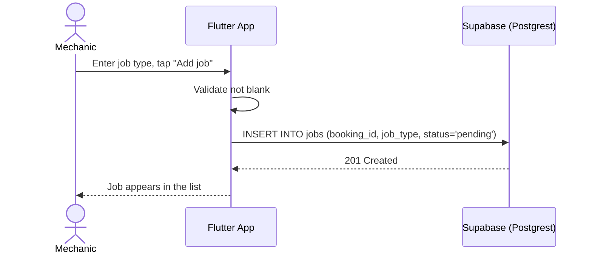
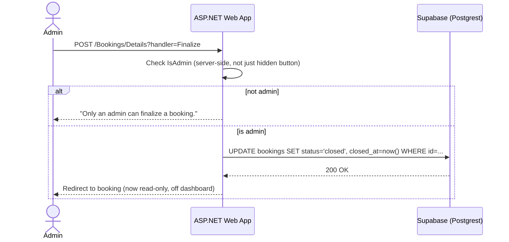
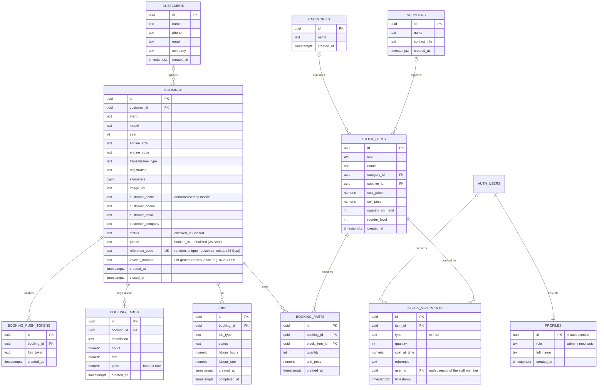

# Activity 3.2 — UML and Database Design

Draft owners: Ofentse Rammutla and Breyton Rossouw, working together
(use case diagram + both sequence diagrams — see
`roles-and-assignments.md` revision history), Wisani (ERD). Everything
below is grounded in the real app and the real Postgres schema — not
invented, so the diagrams should mostly need re-drawing in a proper tool,
not re-designing.

## Part 1 — Use Case Diagram

> **UPDATED 16 Oct 2026 after the Phase 2 presentation (Mr G's feedback).**
> The customer side is now a proper set of use cases, not one oval:
> - **Track repair status** (reference code, web `/Track` or the app)
>   `«include»`s **Check reference code in Supabase** (the
>   `get_booking_by_reference_code` call) and **View phase, parts and labour**;
>   **Show "code not found"** `«extend»`s it for a wrong or unknown code.
> - **Get phase updates on the phone** (push, subscribe with the reference code)
>   also `«include»`s the Supabase check (`register_push_token` refuses unknown codes).
> - **Message customer on WhatsApp** (new staff use case, both roles): staff send
>   the reference code after book-in, then status updates. The Customer receives
>   it; **WhatsApp** is shown as an external `«system»` actor. It uses WhatsApp's
>   free click-to-chat link, so the zero-budget rule still holds (see Change 12
>   in `CHANGELOG.md`).
> - Login lines now meet Login at its ends, so no line crosses another use case.

> **FINAL STRUCTURE — 23 Sept 2026 (supersedes the layout described below).**
> Reference image: `diagrams/usecase-restructured.png`. Sequence references:
> `diagrams/seq-1-book-in-vehicle-flutter.png`, `seq-1b-book-in-vehicle-web.png`,
> `seq-2-admin-finalize-web.png`, `seq-3-admin-delete-web.png`,
> `seq-4-admin-reopen-web.png`.
>
> - **Admin on the left, Mechanic on the right** (separate actors). Ovals in the
>   middle; every shared use case has its own line to each actor.
> - **Dashboard** is one separate box, `«include»`d from Login. Nothing else links
>   back to it (it is a landing screen, not a hub).
> - **Login** `«include»`s "Validate with Supabase Auth" (web and mobile; mobile has
>   real Supabase login since 28 Sept, role read from `profiles`).
> - **Customer** (no login) -> "Check repair status by reference code" (built on mobile 28 Sept).
> - **Update booking phase** (both roles, added 28 Sept) -> pushes a notification to the customer.
> - **Permissions agreed 23 Sept:**
>
> | Use case | Mechanic | Admin |
> |---|---|---|
> | Login, book in a vehicle, search / view bookings (open/closed filter), download invoice, manage stock (incl. restock), update booking (add labour/parts), update booking phase | yes | yes |
> | Finalize & close booking | no | **yes** |
> | Delete booking (includes restock parts, remove jobs) | no | **yes** |
> | Reopen closed booking (re-enter password) | no | **yes** |
> | Remove a part or labour line | no | **yes** |
>
> **Status in code (28 Sept, U3-23):** web gates Finalize, Delete and Reopen;
> mobile gates Finalize, Delete, Reopen and part/labour removal on
> `profiles.role`; the database refuses non-admin deletes once Gary runs
> migration 0007. Mobile changes still need Gary to build and test.
> Sequence diagrams use `Alt` (never `Loop`), Login first, then "Working with
> the system".

**Restructured 2026-09-22 per Ms Mbele's consultation feedback** (see
`consultation-prep-2026-09-22.md` for what was asked, and the "Consultation
outcomes" note below this section for the raw notes and how each point was
read). The base use cases are now fewer and more concise — `Manage
Bookings` and `Manage Stock` each carry a cluster of `«extend»` points
instead of every sub-action being its own top-level oval, `View dashboard`
folded into `Login` as an extension rather than standing alone, and a new
`Customer` actor was added for a same-day feature request.

### Actors

| Actor | What they need to do |
|---|---|
| **Mechanic** (staff, both apps) | Log in, manage bookings (search, update, filter open/closed, download invoice, reopen), manage stock |
| **Admin** (staff, web only, specialised Mechanic) | Everything a Mechanic can do, **plus**: finalize & close a booking, delete a booking (with restock) — both require re-authenticating as Admin |
| **Customer** (walk-in, public, **no login**) — *new, confirmed at the 22 Sept consultation* | Check their vehicle's repair status/phase using a reference code, no account needed |

`Admin` is a **generalization** of `Mechanic`. `Customer` is a separate,
unconnected actor — deliberately not reachable from `Login`, since the
whole point of the new feature is that customers never authenticate.

### Use cases (restructured, base + extend points)

- **Login** *(Mechanic, Admin)*
  - `«extend»` View dashboard — happens immediately on a successful login, not a separately-triggered use case
- **Manage Bookings** *(Mechanic, Admin)*
  - `«extend»` Search bookings / vehicle history (by registration, name, or phone)
  - `«extend»` View a different booking
  - `«extend»` Filter open vs. closed jobs
  - `«extend»` Update a booking (add a job; add a part `«include»`s Decrement stock — see `add_booking_part`)
  - `«extend»` Download invoice (PDF)
  - `«extend»` Reopen a closed booking `«extend»`s Display "incorrect password" error (only when the password check fails) — **shared with Admin, not admin-only (superseded 23 Sept: now admin-only)**, confirmed live 20 Sept (`OnPostReopenAsync` never checks `IsAdmin`)
  - `«extend»` Finalize & close a booking — **{requires re-authentication as Admin}**
  - `«extend»` Delete a booking — **{requires re-authentication as Admin}**, `«include»`s Restock parts and Remove labour/jobs (one atomic call, `delete_booking_and_restock`)
- **Manage Stock** *(Mechanic, Admin)*
  - `«extend»` Search / filter stock
  - `«extend»` Add or restock an item
  - `«extend»` Manage categories and suppliers (create inline)
- **Check repair status** *(Customer only — no `«extend»` from Login)*
  - Enter a reference code, view the booking's current phase — nothing else, no account

### Diagram (Mermaid; redraw as proper UML in draw.io/Lucid)

### Consultation outcomes — 22 Sept, raw notes and how they were read

Straight from the consultation notes, so the group can correct any
misreading before this goes in the SRS:

| Note (as written) | How it was applied |
|---|---|
| "booking and stock both have extensions" | `Manage Bookings` and `Manage Stock` are now base use cases, each with its own `«extend»` cluster, instead of every sub-action (add a job, add a part, add stock, …) being its own top-level oval. |
| "Ovals — limit them and try them closer and more concise" | Collapsed ~14 top-level ovals down to 4 base use cases (Login, Manage Bookings, Manage Stock, Check repair status) plus their extension points. |
| "logins go to bookings (extended to different booking, search and update)" | Read as: after Login, the natural landing point is Bookings — modelled `Manage Bookings` with `«extend»` points for viewing a different booking, searching, and updating. (Login itself only extends to the dashboard, per the next point — Bookings is reached from the dashboard, not directly from Login.) |
| "Split them both on each side and draw lines to the specific things they do" | Bookings cluster and Stock cluster drawn as two separate groups, each fanning out to its own specific extend points. |
| "authentication on the use case extension" | Finalize & close and Delete booking are labelled `{Admin auth}` directly on the extension — the point being that re-authentication, not a separate use case, is what gates them. |
| "Remove viewing dashboard, make it an extension from login" | Done — `View dashboard` is now `«extend»` of `Login`, not a standalone use case. |
| "*Filtering* through open and closed jobs" | Added as `«extend»` "Filter open/closed jobs" under Manage Bookings — wasn't in the diagram before. |
| "Should I add the reference code thing that the customer can enter to view the phase of their car? ... Yes, they don't need to login, even just a screen with updates" | New use case, new `Customer` actor, no login. See "New feature" below. |

### New feature — customer repair-status lookup (confirmed 22 Sept)

A customer enters a reference code (no account, no login) and sees their
vehicle's current repair phase. This is **narrower than** the real-time
customer tracking the group explicitly excluded from scope back in Phase 1
(see the SRS Requirements Change Log) — that was full push-based tracking;
this is a single pull/lookup screen with no live updates and no account.
Worth stating that distinction explicitly in the SRS so it doesn't read as
a scope reversal.

**Outcome (28 Sept): built on mobile by Gary.** He chose option 2 below — a
dedicated random `reference_code` (8 characters, e.g. `CY45KLGP`) — read
through the `get_booking_by_reference_code` function (see
`supabase/migrations/0006`). He also added **push notifications** on every
phase change. That goes beyond "a single pull/lookup screen": it is the
push-based tracking Phase 1 excluded, so the SRS Requirements Change Log must
record it as an approved scope change (confirmed by Ms Mbele's "a screen with
updates"), not leave it looking like a reversal.

**Original open question (22 Sept), kept for history:** what
is the reference code? Two real options against the live schema:
1. Reuse `bookings.invoice_number` (already a DB-generated sequence,
   `INV-00005` style) — no new column, but need to confirm it's assigned
   at check-in and not only once an invoice is downloaded.
2. Add a new short `reference_code` column, generated at booking time,
   deliberately not the same as the registration plate (so the lookup
   screen doesn't become a way to search by plate without logging in).

Whichever is chosen, the lookup page itself is a new **unauthenticated**
route — a real addition to `system-architecture.md`'s access-control story
(everything else in the app sits behind Supabase Auth; this one screen
deliberately doesn't). Target: working by end of day 23 Sept.

## Part 2 — Sequence Diagrams (at least one Flutter, one ASP.NET)

> **Superseded 23 Sept.** The current reference sequence diagrams are the PNGs
> in `diagrams/` with editable draw.io versions in `diagrams/editable/`:
> book in a vehicle (Flutter and web, Login first), admin finalize, admin
> delete, admin reopen. The Mermaid drafts below are the 19 Sept originals
> (the Flutter one wrongly used `jobs`; mobile records labour in
> `booking_labor`) and are kept only for history.

### Diagram 1 — Mechanic adds a job (Flutter -> Supabase)

### Diagram 2 — Admin finalizes a booking (ASP.NET -> Supabase)

### (Optional third) Diagram 3 — Admin deletes a booking, atomic restock

## Part 3 — Entity Relationship Diagram

Taken directly from `web/Models/*.cs` and `supabase/migrations/` — this is
the **real, live schema**, including the customer/invoice columns mobile
added mid-project and the 28 Sept additions (`booking_labor`, `profiles`,
`booking_push_tokens`, `phase`, `reference_code` — columns reconstructed in
`supabase/migrations/0006`, Gary to confirm with `supabase db pull`) (see `web/CLAUDE.md`'s "Schema drift" note).

### Notes for the write-up

- **Redrawn 16 Oct 2026 after Ms Mbele's Phase 2 feedback** ("fix the ERD signs
  and lines"). Every line now runs from the primary key row of the "one" table
  to the foreign key row of the "many" table, with right-angled lines and one
  crow's-foot symbol per end (legend on the diagram). The parent end is
  "zero or one" wherever the foreign key is optional (`bookings.customer_id`,
  `stock_items.category_id`, `stock_items.supplier_id`,
  `stock_movements.user_id`) and "exactly one" where it is `not null`
  (every `booking_id`, `booking_parts.stock_item_id`,
  `stock_movements.item_id`). Added the missing `auth.users` to
  `stock_movements.user_id` line ("records"). The PNG is now rendered from the
  `.drawio` file itself, so the picture and the editable source always match.

- `bookings` also keeps denormalized `customer_name`/`customer_phone`/
  `customer_email`/`customer_company` columns alongside the `customer_id`
  foreign key — a deliberate snapshot so a booking's customer info stays
  correct even if the `customers` record is edited later. Worth a sentence
  in the design rationale.
- `booking_parts` has no `job_id` — parts are booking-wide, not tied to a
  specific job. Flagged in `web/CLAUDE.md` as a known limitation, not
  something to silently redesign away this late.
- Two disconnected labour totals currently exist (`jobs.labour_hours ×
  labour_rate` on web vs. a `booking_labor` table mobile introduced) — this
  is exactly the kind of thing Activity 3.2's "Step 14: Check Alignment"
  is meant to catch. Worth raising with Ms Mbele directly.
