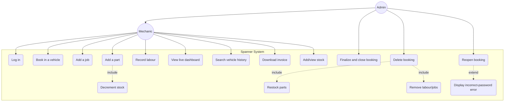
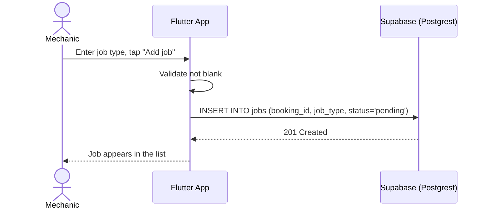
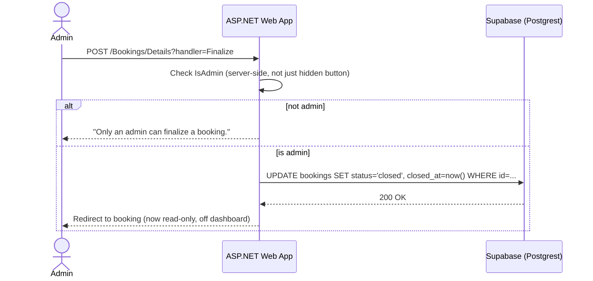
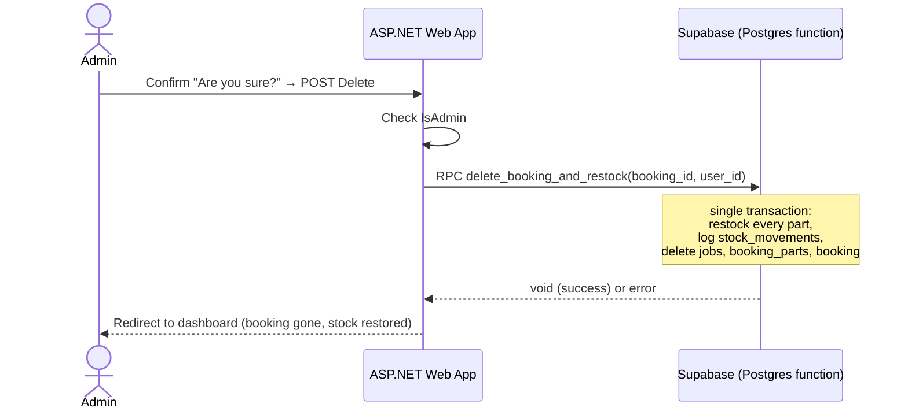
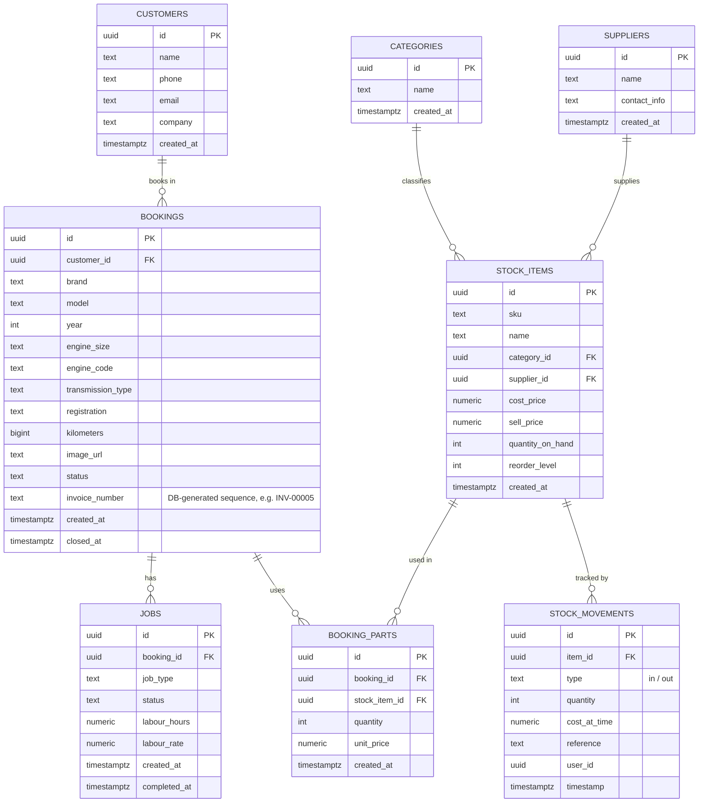

# Activity 3.2 — UML and Database Design

Draft owners: Breyton Rossouw (use case diagram), Wisani + Gary (sequence
diagrams), Wisani (ERD). Everything below is grounded in the real app and
the real Postgres schema — not invented, so the diagrams should mostly need
re-drawing in a proper tool, not re-designing.

## Part 1 — Use Case Diagram

### Actors

Important correction vs. the generic "salon" example in the course
material: **customers are not system actors**. They're walk-in clients —
front-desk staff capture their details on their behalf. The real actors are
staff.

| Actor | What they need to do |
|---|---|
| **Mechanic** (staff, both apps) | Book in a vehicle, add jobs, link parts, record labour, view stock, search vehicle history, download invoices |
| **Admin** (staff, web only, specialised Mechanic) | Everything a Mechanic can do, **plus**: finalize & close a booking, delete a booking (with restock), reopen a closed booking (password-confirmed) |

`Admin` is a **generalization** of `Mechanic` — same relationship as the
course example's "Manager is a specialised Staff User".

### Use cases (from the real app, not hypothetical)

- Log in
- Book in a vehicle (with customer auto-fill/lookup)
- Add a job to a booking
- Add a part to a booking → **`<<include>>`** Decrement stock (always
  happens together — see `add_booking_part`)
- Record labour hours/rate on a job
- View live dashboard (Realtime updates)
- Search vehicle history (by registration, name, or phone)
- Download invoice (PDF)
- Add/view stock; create a new stock category or supplier inline
- Finalize & close a booking *(Admin only)*
- Delete a booking → **`<<include>>`** Restock parts, **`<<include>>`**
  Remove labour/jobs *(Admin only — one atomic call, `delete_booking_and_restock`)*
- Reopen a closed booking → **`<<extend>>`** Display "incorrect password"
  error *(Admin only, only when the password check fails)*

### Diagram (Mermaid; redraw as proper UML in draw.io/Lucid)

## Part 2 — Sequence Diagrams (at least one Flutter, one ASP.NET)

### Diagram 1 — Mechanic adds a job (Flutter → Supabase)

### Diagram 2 — Admin finalizes a booking (ASP.NET → Supabase)

### (Optional third) Diagram 3 — Admin deletes a booking, atomic restock

## Part 3 — Entity Relationship Diagram

Taken directly from `web/Models/*.cs` and `supabase/migrations/` — this is
the **real, live schema**, including the customer/invoice columns mobile
added mid-project (see `web/CLAUDE.md`'s "Schema drift" note).

### Notes for the write-up

- `bookings` also keeps denormalized `customer_name`/`customer_phone`/
  `customer_email`/`customer_company` columns alongside the `customer_id`
  foreign key — a deliberate snapshot so a booking's customer info stays
  correct even if the `customers` record is edited later. Worth a sentence
  in the design rationale.
- `booking_parts` has no `job_id` — parts are booking-wide, not tied to a
  specific job. Flagged in `web/CLAUDE.md` as a known limitation, not
  something to silently redesign away this late.
- Two disconnected labour totals currently exist (`jobs.labour_hours ×
  labour_rate` on web vs. a `booking_labor` table mobile introduced) — this
  is exactly the kind of thing Activity 3.2's "Step 14: Check Alignment"
  is meant to catch. Worth raising with Ms Mbele directly.
