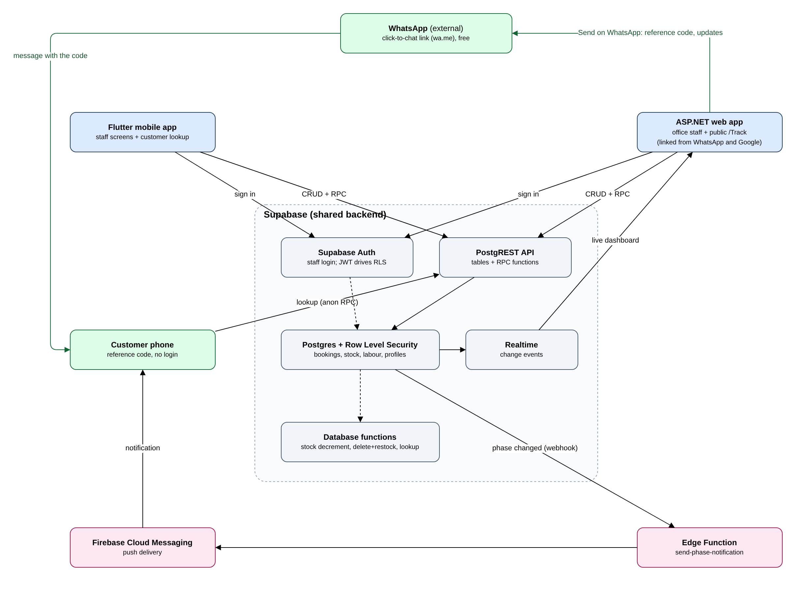
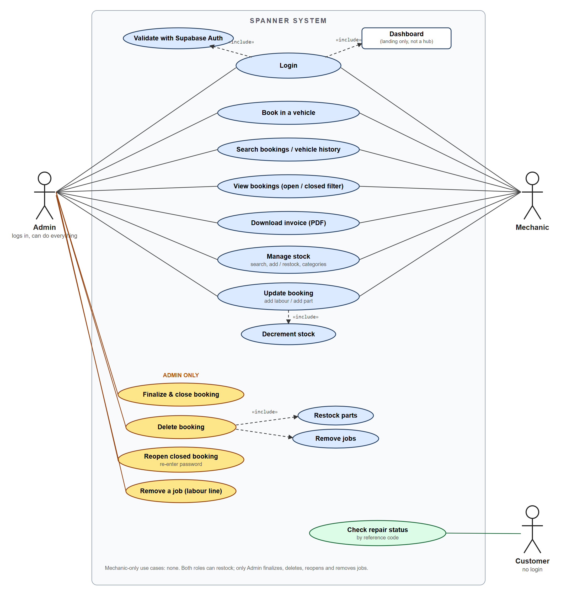
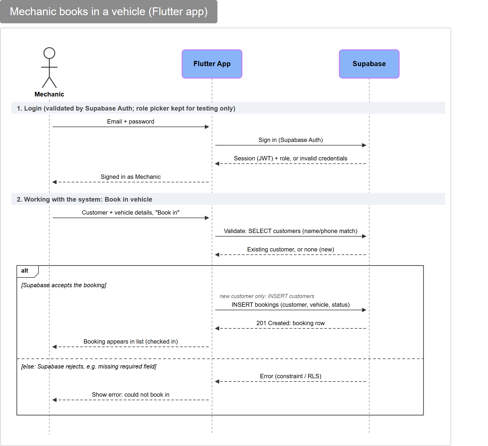
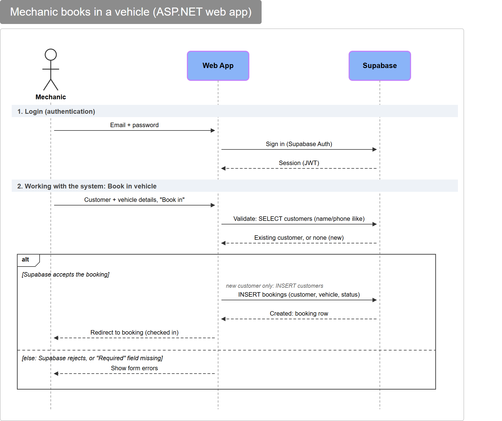
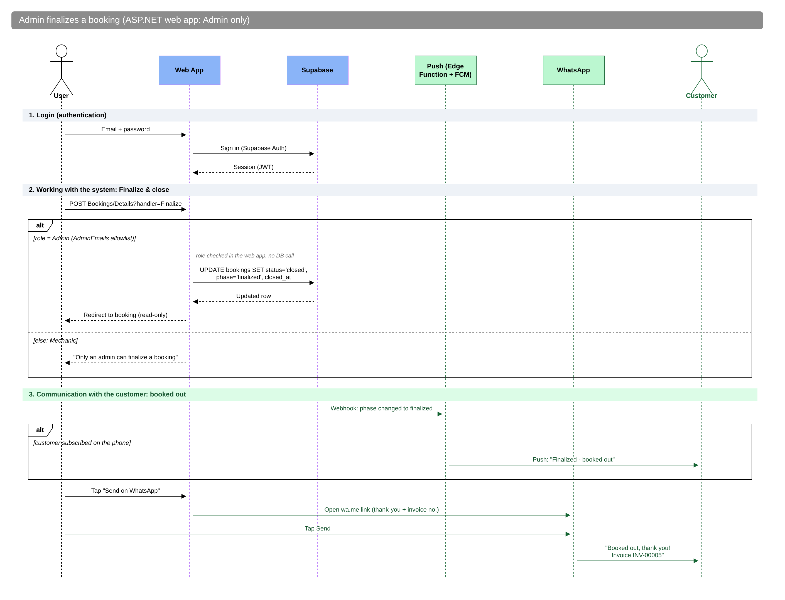
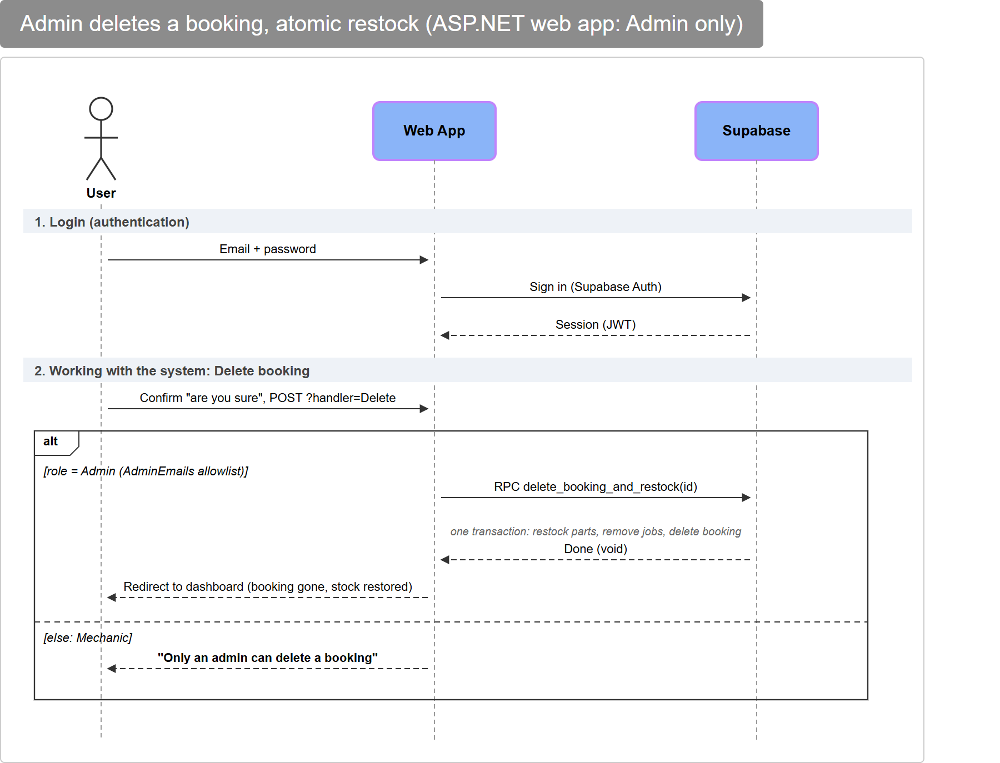
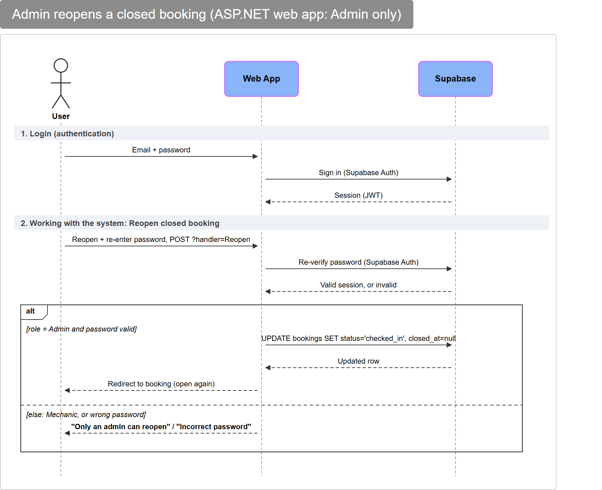
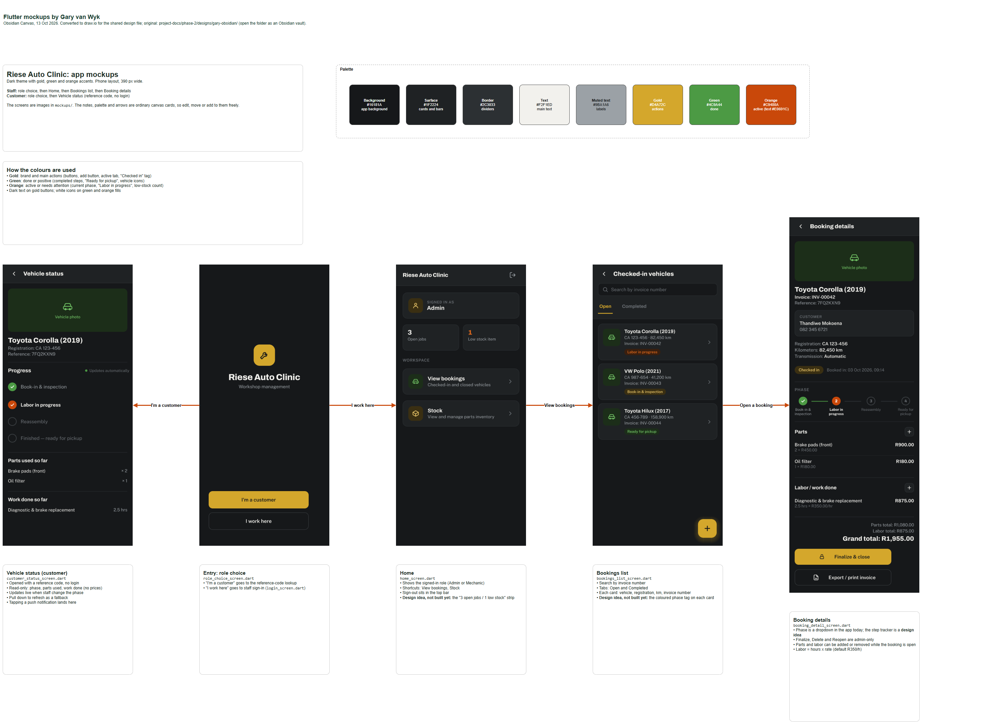
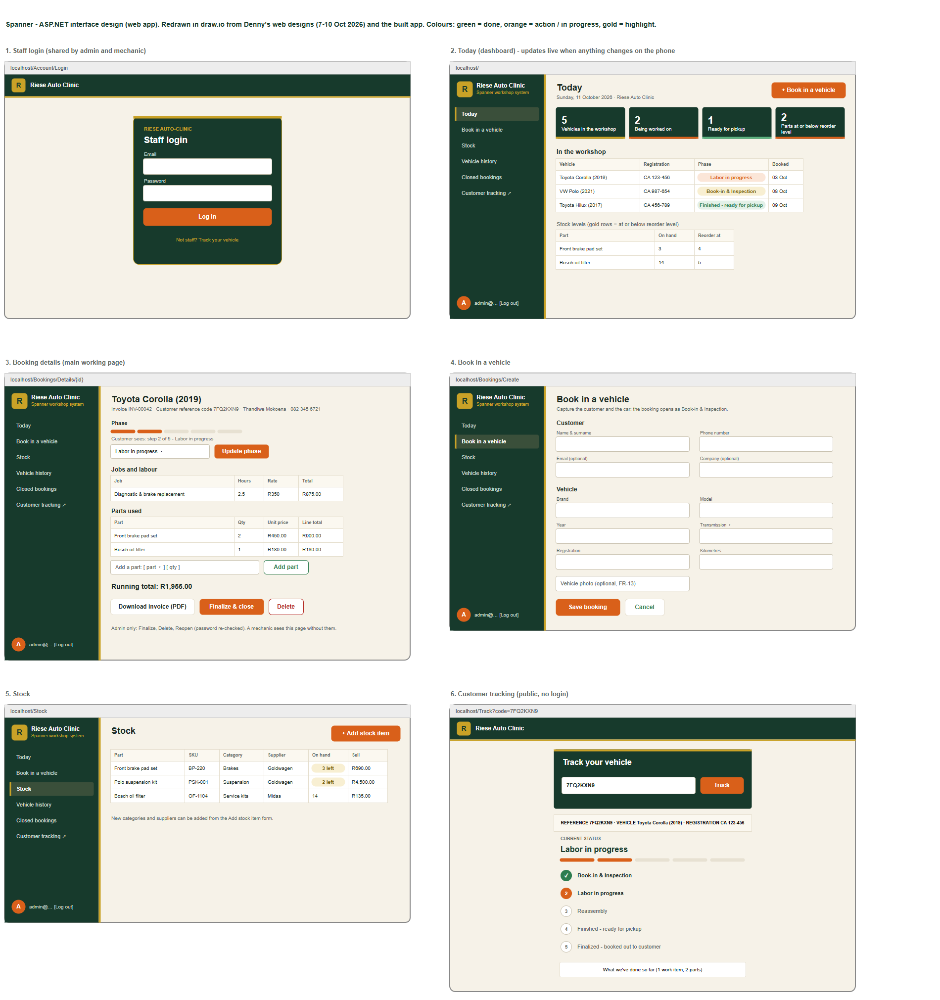
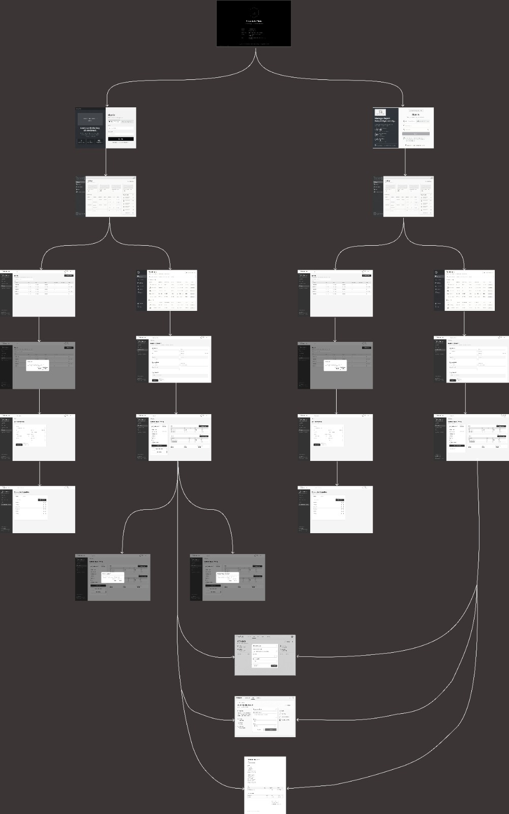

# Phase 2 presentation: Group Y (The Zealots)

**Spanner**, the workshop booking, stock and invoicing system for Riese Auto Clinic.  
ITC327W Assessment 2 (System Architecture and Design). Presentation: **Friday 16 October 2026, 12:00**.

Every link below opens directly. The draw.io links open the editable diagram straight in the browser, with no account and no download. To edit and keep a copy, use **File > Save as** in draw.io.

## Quick links

| What | Open |
|---|---|
| All 13 designs in one draw.io file (one page per design, tabs along the bottom) | [Open in draw.io](https://app.diagrams.net/#Uhttps%3A%2F%2Fraw.githubusercontent.com%2FBlackZ3ro%2FSpanner-Riese-Auto-Clinic%2Fmain%2Fproject-docs%2Fphase-2%2Fdiagrams%2Feditable%2Fspanner-all-designs.drawio) |
| SRS v2.2 (Phase 2), the submitted document | [Open PDF](../../project-docs/Group%20Y%20-%20SRS%20v2.2%20%28Phase%202%20-%20System%20Architecture%20and%20Design%29.pdf) |
| Microsoft Project schedule (Gantt) | [Screenshot](../../project-docs/phase-2/schedule/ms-project-gantt.png) · [XML for MS Project](../../project-docs/phase-2/schedule/TheZealotsSchedule%20%28Phase%202%20update%2011%20Oct%29.xml) |
| Progress Checker (tasks, contributions, reflection) | [Download .xlsx](../../project-docs/phase-2/tracker/Group%20Y%20-%20ITC327W%20Progress%20Checker%20%28Phase%202%20final%29.xlsx) |
| Use case diagram (Lucidchart) | [Open in Lucidchart](https://lucid.app/lucidchart/fb4ebb76-2892-4f1a-888f-067c37aca98d/view) |
| Sequence diagrams (Lucidchart) | [Open in Lucidchart](https://lucid.app/lucidchart/285c1247-0f85-4e60-879c-90f48a0c91f6/view) |
| ASP.NET web designs (Figma prototype) | [Open in Figma](https://www.figma.com/proto/yoiClYQl9oJNOD2pCRRplW/riese-auto-clinic-final-design?node-id=22-2240&t=xsFRVUIDXuvZZXlL-1&scaling=min-zoom&content-scaling=fixed&page-id=0%3A1) |
| Submission ZIP (as submitted on eThuto) | [Download ZIP](../../submission/Group%20Y%20Phase%202.zip) |
| Source code: ASP.NET web app | [web/](../../web) · [Pages](../../web/Pages) |
| Source code: Flutter mobile app | [mobile/](../../mobile) |
| Database: Supabase migrations | [supabase/migrations](../../supabase/migrations) |

## Running order (suggested)

1. **The problem and the client.** Riese Auto Clinic runs bookings, stock and costing from memory and paper. See SRS section 1.
2. **Architecture** (Fig. 1). One shared Supabase backend for the Flutter app (mechanics) and the ASP.NET web app (front desk/admin).
3. **Use case and sequence diagrams** (Fig. 2 to 7). Admin-only paths: finalize, delete with atomic restock, reopen.
4. **ERD** (Fig. 8). Drawn from the live schema; `bookings` is the centre.
5. **Interface designs** (Fig. 9a to 10c, 13). Each member's own design, then the draw.io versions and the navigation flow.
6. **Live demo of the web app.** Follow the [demo script](../../web/docs/demo-script.md) (about 3 minutes).
7. **Schedule and progress.** Gantt screenshot and the Progress Checker.
8. **Questions.**

## Designs

Each design: the picture, a one-click link to the editable draw.io source, and any other tool it was made in.

### Fig. 1 · System architecture

[Edit in draw.io](https://app.diagrams.net/#Uhttps%3A%2F%2Fraw.githubusercontent.com%2FBlackZ3ro%2FSpanner-Riese-Auto-Clinic%2Fmain%2Fproject-docs%2Fphase-2%2Fdiagrams%2Feditable%2Farchitecture.drawio) · [.drawio file](../../project-docs/phase-2/diagrams/editable/architecture.drawio)

### Fig. 2 · Use case diagram (by Ofentse and Breyton)

[Edit in draw.io](https://app.diagrams.net/#Uhttps%3A%2F%2Fraw.githubusercontent.com%2FBlackZ3ro%2FSpanner-Riese-Auto-Clinic%2Fmain%2Fproject-docs%2Fphase-2%2Fdiagrams%2Feditable%2Fusecase.drawio) · [Lucidchart](https://lucid.app/lucidchart/fb4ebb76-2892-4f1a-888f-067c37aca98d/view) · [.drawio file](../../project-docs/phase-2/diagrams/editable/usecase.drawio)

### Fig. 3 · Sequence: mechanic books in a vehicle (Flutter) (by Ofentse and Breyton)

[Edit in draw.io](https://app.diagrams.net/#Uhttps%3A%2F%2Fraw.githubusercontent.com%2FBlackZ3ro%2FSpanner-Riese-Auto-Clinic%2Fmain%2Fproject-docs%2Fphase-2%2Fdiagrams%2Feditable%2Fseq-1-book-in-vehicle-flutter.drawio) · [Lucidchart](https://lucid.app/lucidchart/285c1247-0f85-4e60-879c-90f48a0c91f6/view) · [.drawio file](../../project-docs/phase-2/diagrams/editable/seq-1-book-in-vehicle-flutter.drawio)

### Fig. 4 · Sequence: mechanic books in a vehicle (ASP.NET) (by Ofentse and Breyton)

[Edit in draw.io](https://app.diagrams.net/#Uhttps%3A%2F%2Fraw.githubusercontent.com%2FBlackZ3ro%2FSpanner-Riese-Auto-Clinic%2Fmain%2Fproject-docs%2Fphase-2%2Fdiagrams%2Feditable%2Fseq-1b-book-in-vehicle-web.drawio) · [Lucidchart](https://lucid.app/lucidchart/285c1247-0f85-4e60-879c-90f48a0c91f6/view) · [.drawio file](../../project-docs/phase-2/diagrams/editable/seq-1b-book-in-vehicle-web.drawio)

### Fig. 5 · Sequence: admin finalizes a booking (by Ofentse and Breyton)

[Edit in draw.io](https://app.diagrams.net/#Uhttps%3A%2F%2Fraw.githubusercontent.com%2FBlackZ3ro%2FSpanner-Riese-Auto-Clinic%2Fmain%2Fproject-docs%2Fphase-2%2Fdiagrams%2Feditable%2Fseq-2-admin-finalize-web.drawio) · [Lucidchart](https://lucid.app/lucidchart/285c1247-0f85-4e60-879c-90f48a0c91f6/view) · [.drawio file](../../project-docs/phase-2/diagrams/editable/seq-2-admin-finalize-web.drawio)

### Fig. 6 · Sequence: admin deletes a booking (atomic restock) (by Ofentse and Breyton)

[Edit in draw.io](https://app.diagrams.net/#Uhttps%3A%2F%2Fraw.githubusercontent.com%2FBlackZ3ro%2FSpanner-Riese-Auto-Clinic%2Fmain%2Fproject-docs%2Fphase-2%2Fdiagrams%2Feditable%2Fseq-3-admin-delete-web.drawio) · [Lucidchart](https://lucid.app/lucidchart/285c1247-0f85-4e60-879c-90f48a0c91f6/view) · [.drawio file](../../project-docs/phase-2/diagrams/editable/seq-3-admin-delete-web.drawio)

### Fig. 7 · Sequence: admin reopens a closed booking (by Ofentse and Breyton)

[Edit in draw.io](https://app.diagrams.net/#Uhttps%3A%2F%2Fraw.githubusercontent.com%2FBlackZ3ro%2FSpanner-Riese-Auto-Clinic%2Fmain%2Fproject-docs%2Fphase-2%2Fdiagrams%2Feditable%2Fseq-4-admin-reopen-web.drawio) · [Lucidchart](https://lucid.app/lucidchart/285c1247-0f85-4e60-879c-90f48a0c91f6/view) · [.drawio file](../../project-docs/phase-2/diagrams/editable/seq-4-admin-reopen-web.drawio)

### Fig. 8 · ERD (live Supabase schema)

[Edit in draw.io](https://app.diagrams.net/#Uhttps%3A%2F%2Fraw.githubusercontent.com%2FBlackZ3ro%2FSpanner-Riese-Auto-Clinic%2Fmain%2Fproject-docs%2Fphase-2%2Fdiagrams%2Feditable%2Ferd.drawio) · [.drawio file](../../project-docs/phase-2/diagrams/editable/erd.drawio)

### Fig. 9a · Flutter mockups (by Gary van Wyk)

[Edit in draw.io](https://app.diagrams.net/#Uhttps%3A%2F%2Fraw.githubusercontent.com%2FBlackZ3ro%2FSpanner-Riese-Auto-Clinic%2Fmain%2Fproject-docs%2Fphase-2%2Fdiagrams%2Feditable%2Fgary-flutter-mockups.drawio) · [Obsidian canvas (GitHub)](https://github.com/BlackZ3ro/Spanner-Riese-Auto-Clinic/tree/main/project-docs/phase-2/designs/gary-obsidian) · [.drawio file](../../project-docs/phase-2/diagrams/editable/gary-flutter-mockups.drawio)

### Fig. 9b · Flutter screens

[Edit in draw.io](https://app.diagrams.net/#Uhttps%3A%2F%2Fraw.githubusercontent.com%2FBlackZ3ro%2FSpanner-Riese-Auto-Clinic%2Fmain%2Fproject-docs%2Fphase-2%2Fdiagrams%2Feditable%2Fflutter-screens.drawio) · [.drawio file](../../project-docs/phase-2/diagrams/editable/flutter-screens.drawio)

### Fig. 10a · ASP.NET designs (Figma) (by Denny (Mathye MD))

[Edit in draw.io](https://app.diagrams.net/#Uhttps%3A%2F%2Fraw.githubusercontent.com%2FBlackZ3ro%2FSpanner-Riese-Auto-Clinic%2Fmain%2Fproject-docs%2Fphase-2%2Fdiagrams%2Feditable%2Fdenny-web-designs.drawio) · [Figma prototype](https://www.figma.com/proto/yoiClYQl9oJNOD2pCRRplW/riese-auto-clinic-final-design?node-id=22-2240&t=xsFRVUIDXuvZZXlL-1&scaling=min-zoom&content-scaling=fixed&page-id=0%3A1) · [HTML prototype + screenshots](https://github.com/BlackZ3ro/Spanner-Riese-Auto-Clinic/tree/main/project-docs/phase-2/designs/denny-figma) · [.drawio file](../../project-docs/phase-2/diagrams/editable/denny-web-designs.drawio)

### Fig. 10b · ASP.NET screens

[Edit in draw.io](https://app.diagrams.net/#Uhttps%3A%2F%2Fraw.githubusercontent.com%2FBlackZ3ro%2FSpanner-Riese-Auto-Clinic%2Fmain%2Fproject-docs%2Fphase-2%2Fdiagrams%2Feditable%2Faspnet-screens.drawio) · [.drawio file](../../project-docs/phase-2/diagrams/editable/aspnet-screens.drawio)

### Fig. 10c · ASP.NET wireframe flow (by Kea (Keamogetse Kgosi))

[Wireframe image](https://github.com/BlackZ3ro/Spanner-Riese-Auto-Clinic/blob/main/project-docs/phase-2/designs/kea-web-wireframe/kea-web-wireframe-flow.jpg)

### Fig. 13 · Navigation flow (Flutter and ASP.NET)

[Edit in draw.io](https://app.diagrams.net/#Uhttps%3A%2F%2Fraw.githubusercontent.com%2FBlackZ3ro%2FSpanner-Riese-Auto-Clinic%2Fmain%2Fproject-docs%2Fphase-2%2Fdiagrams%2Feditable%2Fnavigation-flow.drawio) · [.drawio file](../../project-docs/phase-2/diagrams/editable/navigation-flow.drawio)

## If a link does not open

- **draw.io:** go to <https://app.diagrams.net>, choose **Device**, and open the `.drawio` file from the submission ZIP (`design-sources/`) or from [the editable folder](../../project-docs/phase-2/diagrams/editable/).
- **No internet:** every `.drawio` file, the SRS and the schedule are also in the submission ZIP.
- **Customer tracking (mobile) branch:** the SRS mentions the branch `proposal/mobile-customer-tracking`, which is no longer on GitHub. The web version is in [web/Pages/Track](../../web/Pages/Track).

## Team

Gary van Wyk, Keamogetse Kgosi (Kea), Moremi KE (Khumo), Mathye MD (Denny), Wisani Nkuna, Ofentse Rammutla, Breyton Rossouw. See [CONTRIBUTORS.md](../../CONTRIBUTORS.md).
