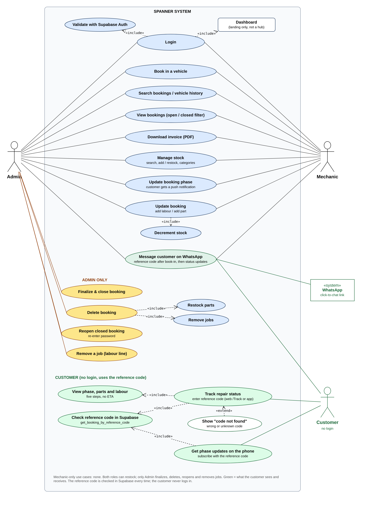
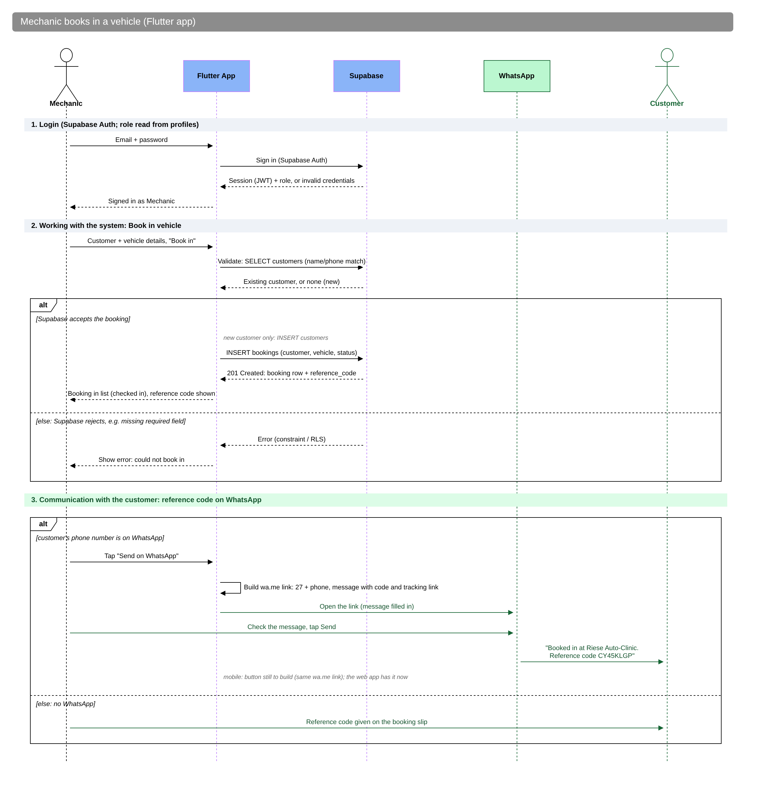
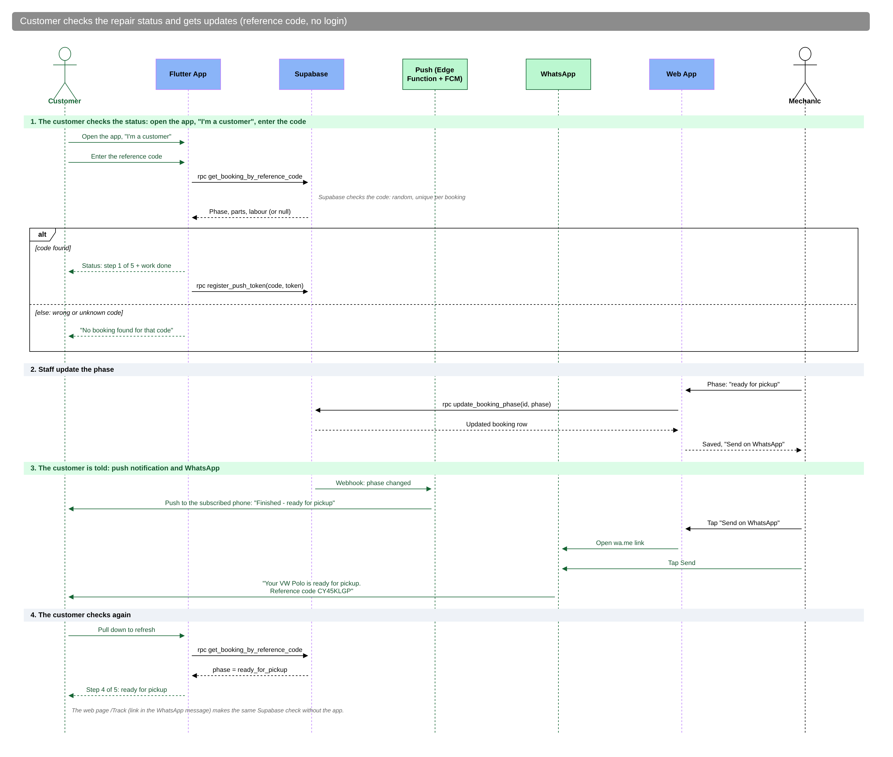
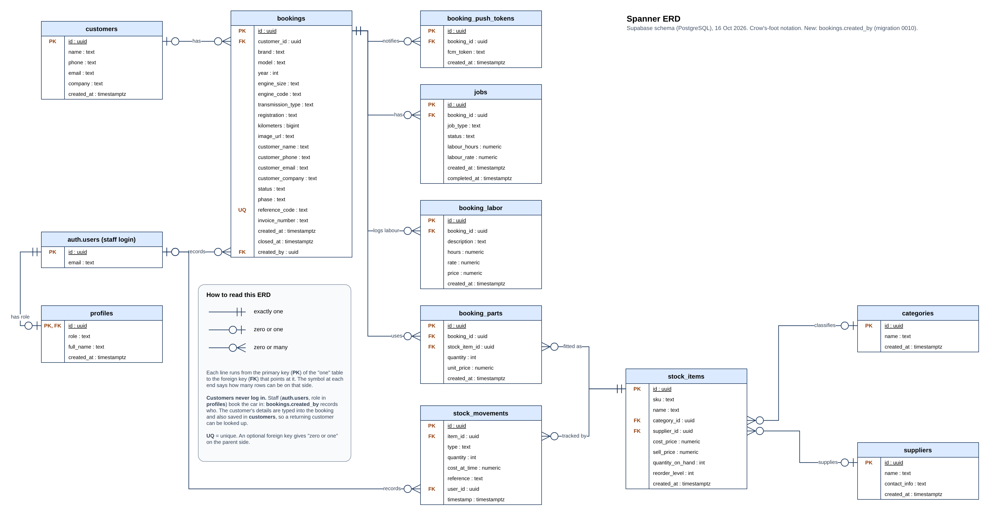
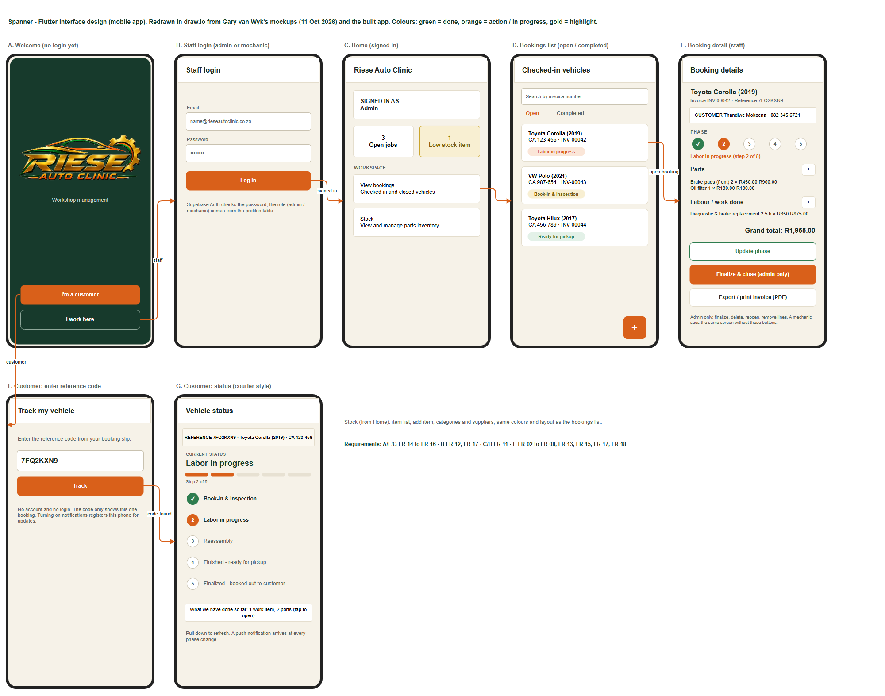
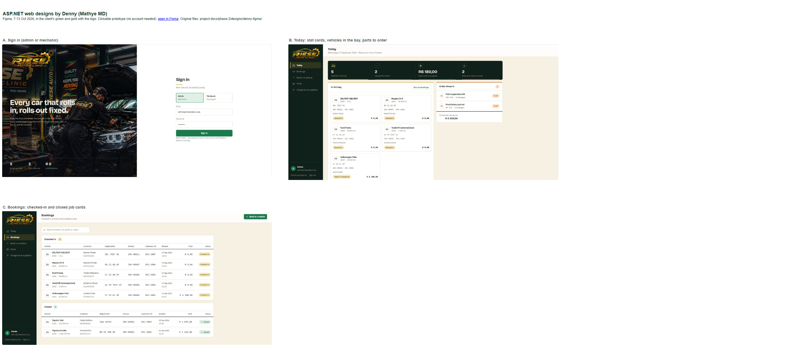
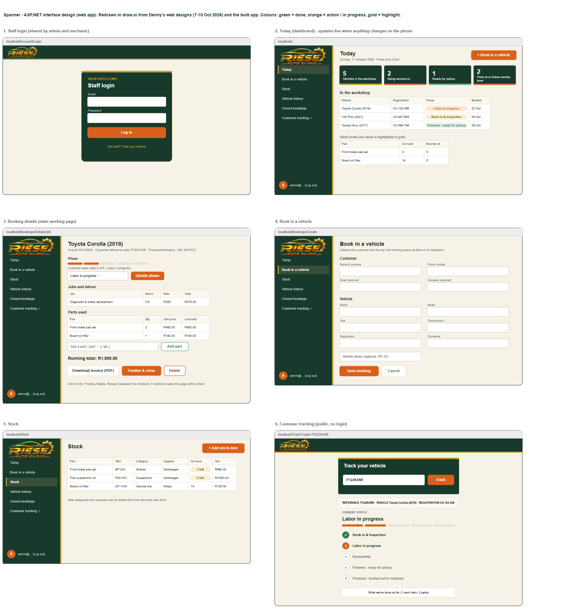
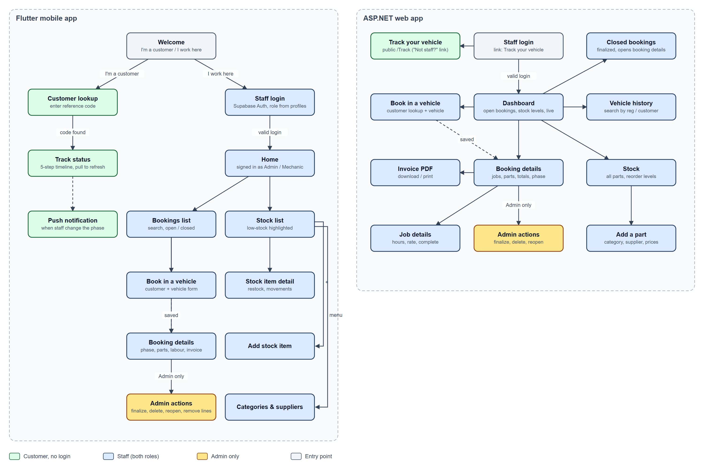

# Phase 2 presentation: Group Y (The Zealots)

**Spanner**, the workshop booking, stock and invoicing system for Riese Auto Clinic.  
ITC327W Assessment 2 (System Architecture and Design). Everything to present is in this folder.

The **Edit in draw.io** links open the editable diagram straight in the browser, with no account and no download. To keep an edited copy, use **File > Save as** in draw.io.

## Feedback from the 16 Oct presentation, and what changed

| Who | Feedback | What changed | Open it |
|---|---|---|---|
| Ms Mbele | Fix the ERD signs and lines; "customer books in" reads as if the customer uses the system; where is the mechanic? | ERD redrawn: crow's-foot symbol at each end, every line from PK to FK, legend; customers line now "has"; new `bookings.created_by` links the staff member who booked the car in | [ERD](2-designs/08-erd.png) · [Edit in draw.io](https://app.diagrams.net/#Uhttps%3A%2F%2Fraw.githubusercontent.com%2FBlackZ3ro%2FSpanner-Riese-Auto-Clinic%2Fmain%2Fproject-docs%2Fphase-2%2Fdiagrams%2Feditable%2Ferd.drawio) |
| Mr G | Customer use case should include the Supabase check and updates; a good use case has code, a table and user input behind it | Customer use cases: Track repair status includes the Supabase check; push updates; WhatsApp messages. Every use case mapped to user input, code and table | [Use case](2-designs/02-usecase-restructured.png) · [Traceability table](../../project-docs/phase-2/use-case-traceability.md) |
| Mr G | Include the communication with the client in the sequence (open the app, I'm a customer, enter the code, see the status) | Book-in and finalize sequences now message the customer; new customer sequence | [Customer sequence](2-designs/07b-seq-5-customer-updates.png) · [Book in (web)](2-designs/04-seq-1b-book-in-vehicle-web.png) |
| Mr G | Bonus: a button that sends the reference code on WhatsApp | **Send on WhatsApp** on the web booking page (free click-to-chat link, no paid API) | [Code](../../web/Services/CustomerWhatsApp.cs) · [How to try it](../../web/README.md) |
| Mr G | Riese does not come up on Google | Step-by-step for Michael to set up a free Google Business Profile; public pages now titled for Riese | [Google guide](../../project-docs/phase-2/google-business-profile.md) |
| Ms Mbele | The schedule showed the presentation in the future (23 Oct) and did not capture the late submission | Presentation back on 16 Oct; Phase 2 submission shown with its 13 Oct 23:59 deadline, done 14 Oct; progress filled in; tracker updated | [Gantt](4-schedule/gantt-corrected-16-Oct.png) · [Tracker](5-progress-and-demo/Group-Y-Progress-Checker-Phase-2-updated-16-Oct.xlsx) |

Still to do: Gary runs migration 0010 and adds the WhatsApp button to the mobile app; Michael sets up the Google profile; SRS v2.3. Full list: [CHANGELOG, 16 Oct](../../project-docs/phase-2/CHANGELOG.md).

## What is in this folder

| Folder | Contents |
|---|---|
| [1-srs](1-srs) | [SRS v2.2 (Phase 2)](1-srs/Group-Y-SRS-v2.2-Phase-2.pdf), the submitted document |
| [2-designs](2-designs) | Every design as a picture, numbered in presenting order |
| [3-design-sources](3-design-sources) | Every editable `.drawio` file. [All 14 designs in one file, open in draw.io](https://app.diagrams.net/#Uhttps%3A%2F%2Fraw.githubusercontent.com%2FBlackZ3ro%2FSpanner-Riese-Auto-Clinic%2Fmain%2Fproject-docs%2Fphase-2%2Fdiagrams%2Feditable%2Fspanner-all-designs.drawio) |
| [4-schedule](4-schedule) | **Corrected schedule, 16 Oct:** [Gantt](4-schedule/gantt-corrected-16-Oct.png) · [MS Project XML](4-schedule/TheZealotsSchedule-corrected-16-Oct.xml) (open in MS Project, save as .mpp). Earlier versions: [Khumo's 16 Oct .mpp](4-schedule/TheZealotsSchedule.mpp) · [Gantt as submitted, 11 Oct](4-schedule/gantt-as-submitted-11-Oct.png) · [XML as submitted](4-schedule/TheZealotsSchedule-as-submitted-11-Oct.xml) |
| [5-progress-and-demo](5-progress-and-demo) | [Progress Checker, updated 16 Oct (.xlsx)](5-progress-and-demo/Group-Y-Progress-Checker-Phase-2-updated-16-Oct.xlsx) · [Web app demo script](5-progress-and-demo/demo-script.md) |

## Other links

| What | Open |
|---|---|
| Use case diagram (Lucidchart) | [Open in Lucidchart](https://lucid.app/lucidchart/fb4ebb76-2892-4f1a-888f-067c37aca98d/view) |
| Sequence diagrams (Lucidchart) | [Open in Lucidchart](https://lucid.app/lucidchart/285c1247-0f85-4e60-879c-90f48a0c91f6/view) |
| ASP.NET web designs (Figma prototype) | [Open in Figma](https://www.figma.com/proto/yoiClYQl9oJNOD2pCRRplW/riese-auto-clinic-final-design?node-id=22-2240&t=xsFRVUIDXuvZZXlL-1&scaling=min-zoom&content-scaling=fixed&page-id=0%3A1) |
| Source code: ASP.NET web app | [web/](../../web) |
| Source code: Flutter mobile app | [mobile/](../../mobile) |
| Database: Supabase migrations | [supabase/migrations](../../supabase/migrations) |
| Submission ZIP (as submitted on eThuto) | [Download ZIP](../Group%20Y%20Phase%202.zip) |

## Running order (suggested)

1. **The problem and the client.** Riese Auto Clinic runs bookings, stock and costing from memory and paper. See SRS section 1.
2. **Architecture** (Fig. 1). One shared Supabase backend for the Flutter app (mechanics) and the ASP.NET web app (front desk/admin).
3. **Use case and sequence diagrams** (Fig. 2 to 7). Admin-only paths: finalize, delete with atomic restock, reopen.
4. **ERD** (Fig. 8). Drawn from the live schema; `bookings` is the centre.
5. **Interface designs** (Fig. 9a to 10c, 13). Each member's own design, then the draw.io versions and the navigation flow.
6. **Live demo of the web app.** Follow the [demo script](5-progress-and-demo/demo-script.md) (about 3 minutes). For Mr G's bonus: book in a vehicle with his phone number and tap **Send on WhatsApp** on the booking page.
7. **Schedule and progress.** The [corrected schedule](4-schedule/gantt-corrected-16-Oct.png) (presentation on 16 Oct, late submission shown against its deadline) and the [Progress Checker](5-progress-and-demo/Group-Y-Progress-Checker-Phase-2-updated-16-Oct.xlsx).
8. **Questions.**

## Designs

### Fig. 1 · System architecture

[Edit in draw.io](https://app.diagrams.net/#Uhttps%3A%2F%2Fraw.githubusercontent.com%2FBlackZ3ro%2FSpanner-Riese-Auto-Clinic%2Fmain%2Fproject-docs%2Fphase-2%2Fdiagrams%2Feditable%2Farchitecture.drawio) · [.drawio file](3-design-sources/architecture.drawio)

### Fig. 2 · Use case diagram (by Ofentse and Breyton)

[Edit in draw.io](https://app.diagrams.net/#Uhttps%3A%2F%2Fraw.githubusercontent.com%2FBlackZ3ro%2FSpanner-Riese-Auto-Clinic%2Fmain%2Fproject-docs%2Fphase-2%2Fdiagrams%2Feditable%2Fusecase.drawio) · [.drawio file](3-design-sources/usecase.drawio) · [Lucidchart](https://lucid.app/lucidchart/fb4ebb76-2892-4f1a-888f-067c37aca98d/view)

### Fig. 3 · Sequence: mechanic books in a vehicle (Flutter) (by Ofentse and Breyton)

[Edit in draw.io](https://app.diagrams.net/#Uhttps%3A%2F%2Fraw.githubusercontent.com%2FBlackZ3ro%2FSpanner-Riese-Auto-Clinic%2Fmain%2Fproject-docs%2Fphase-2%2Fdiagrams%2Feditable%2Fseq-1-book-in-vehicle-flutter.drawio) · [.drawio file](3-design-sources/seq-1-book-in-vehicle-flutter.drawio) · [Lucidchart](https://lucid.app/lucidchart/285c1247-0f85-4e60-879c-90f48a0c91f6/view)

### Fig. 4 · Sequence: mechanic books in a vehicle (ASP.NET) (by Ofentse and Breyton)

[Edit in draw.io](https://app.diagrams.net/#Uhttps%3A%2F%2Fraw.githubusercontent.com%2FBlackZ3ro%2FSpanner-Riese-Auto-Clinic%2Fmain%2Fproject-docs%2Fphase-2%2Fdiagrams%2Feditable%2Fseq-1b-book-in-vehicle-web.drawio) · [.drawio file](3-design-sources/seq-1b-book-in-vehicle-web.drawio) · [Lucidchart](https://lucid.app/lucidchart/285c1247-0f85-4e60-879c-90f48a0c91f6/view)

### Fig. 5 · Sequence: admin finalizes a booking (by Ofentse and Breyton)

[Edit in draw.io](https://app.diagrams.net/#Uhttps%3A%2F%2Fraw.githubusercontent.com%2FBlackZ3ro%2FSpanner-Riese-Auto-Clinic%2Fmain%2Fproject-docs%2Fphase-2%2Fdiagrams%2Feditable%2Fseq-2-admin-finalize-web.drawio) · [.drawio file](3-design-sources/seq-2-admin-finalize-web.drawio) · [Lucidchart](https://lucid.app/lucidchart/285c1247-0f85-4e60-879c-90f48a0c91f6/view)

### Fig. 6 · Sequence: admin deletes a booking (atomic restock) (by Ofentse and Breyton)

[Edit in draw.io](https://app.diagrams.net/#Uhttps%3A%2F%2Fraw.githubusercontent.com%2FBlackZ3ro%2FSpanner-Riese-Auto-Clinic%2Fmain%2Fproject-docs%2Fphase-2%2Fdiagrams%2Feditable%2Fseq-3-admin-delete-web.drawio) · [.drawio file](3-design-sources/seq-3-admin-delete-web.drawio) · [Lucidchart](https://lucid.app/lucidchart/285c1247-0f85-4e60-879c-90f48a0c91f6/view)

### Fig. 7 · Sequence: admin reopens a closed booking (by Ofentse and Breyton)

[Edit in draw.io](https://app.diagrams.net/#Uhttps%3A%2F%2Fraw.githubusercontent.com%2FBlackZ3ro%2FSpanner-Riese-Auto-Clinic%2Fmain%2Fproject-docs%2Fphase-2%2Fdiagrams%2Feditable%2Fseq-4-admin-reopen-web.drawio) · [.drawio file](3-design-sources/seq-4-admin-reopen-web.drawio) · [Lucidchart](https://lucid.app/lucidchart/285c1247-0f85-4e60-879c-90f48a0c91f6/view)

### Fig. 7b · Sequence: customer checks the status and gets updates (new, 16 Oct)

[Edit in draw.io](https://app.diagrams.net/#Uhttps%3A%2F%2Fraw.githubusercontent.com%2FBlackZ3ro%2FSpanner-Riese-Auto-Clinic%2Fmain%2Fproject-docs%2Fphase-2%2Fdiagrams%2Feditable%2Fseq-5-customer-updates.drawio) · [.drawio file](3-design-sources/seq-5-customer-updates.drawio)

### Fig. 8 · ERD (crow's-foot notation, redrawn 16 Oct)

[Edit in draw.io](https://app.diagrams.net/#Uhttps%3A%2F%2Fraw.githubusercontent.com%2FBlackZ3ro%2FSpanner-Riese-Auto-Clinic%2Fmain%2Fproject-docs%2Fphase-2%2Fdiagrams%2Feditable%2Ferd.drawio) · [.drawio file](3-design-sources/erd.drawio)

### Fig. 9a · Flutter mockups (by Gary van Wyk)

[Edit in draw.io](https://app.diagrams.net/#Uhttps%3A%2F%2Fraw.githubusercontent.com%2FBlackZ3ro%2FSpanner-Riese-Auto-Clinic%2Fmain%2Fproject-docs%2Fphase-2%2Fdiagrams%2Feditable%2Fgary-flutter-mockups.drawio) · [.drawio file](3-design-sources/gary-flutter-mockups.drawio) · [Obsidian canvas](https://github.com/BlackZ3ro/Spanner-Riese-Auto-Clinic/tree/main/project-docs/phase-2/designs/gary-obsidian)

### Fig. 9b · Flutter screens

[Edit in draw.io](https://app.diagrams.net/#Uhttps%3A%2F%2Fraw.githubusercontent.com%2FBlackZ3ro%2FSpanner-Riese-Auto-Clinic%2Fmain%2Fproject-docs%2Fphase-2%2Fdiagrams%2Feditable%2Fflutter-screens.drawio) · [.drawio file](3-design-sources/flutter-screens.drawio)

### Fig. 10a · ASP.NET designs (Figma) (by Denny (Mathye MD))

[Edit in draw.io](https://app.diagrams.net/#Uhttps%3A%2F%2Fraw.githubusercontent.com%2FBlackZ3ro%2FSpanner-Riese-Auto-Clinic%2Fmain%2Fproject-docs%2Fphase-2%2Fdiagrams%2Feditable%2Fdenny-web-designs.drawio) · [.drawio file](3-design-sources/denny-web-designs.drawio) · [Figma prototype](https://www.figma.com/proto/yoiClYQl9oJNOD2pCRRplW/riese-auto-clinic-final-design?node-id=22-2240&t=xsFRVUIDXuvZZXlL-1&scaling=min-zoom&content-scaling=fixed&page-id=0%3A1) · [HTML prototype](https://github.com/BlackZ3ro/Spanner-Riese-Auto-Clinic/tree/main/project-docs/phase-2/designs/denny-figma)

### Fig. 10b · ASP.NET screens

[Edit in draw.io](https://app.diagrams.net/#Uhttps%3A%2F%2Fraw.githubusercontent.com%2FBlackZ3ro%2FSpanner-Riese-Auto-Clinic%2Fmain%2Fproject-docs%2Fphase-2%2Fdiagrams%2Feditable%2Faspnet-screens.drawio) · [.drawio file](3-design-sources/aspnet-screens.drawio)

### Fig. 10c · ASP.NET wireframe flow (by Kea (Keamogetse Kgosi))

### Fig. 13 · Navigation flow (Flutter and ASP.NET)

[Edit in draw.io](https://app.diagrams.net/#Uhttps%3A%2F%2Fraw.githubusercontent.com%2FBlackZ3ro%2FSpanner-Riese-Auto-Clinic%2Fmain%2Fproject-docs%2Fphase-2%2Fdiagrams%2Feditable%2Fnavigation-flow.drawio) · [.drawio file](3-design-sources/navigation-flow.drawio)

## If a link does not open

- **draw.io:** go to <https://app.diagrams.net>, choose **Device**, and open the file from [3-design-sources](3-design-sources).
- **No internet:** download this folder; every picture, `.drawio` file, the SRS, schedule and Progress Checker are in it.
- **Customer tracking (mobile) branch:** the SRS mentions the branch `proposal/mobile-customer-tracking`, which is no longer on GitHub. The web version is in [web/Pages/Track](../../web/Pages/Track).

## Team

Gary van Wyk, Keamogetse Kgosi (Kea), Moremi KE (Khumo), Mathye MD (Denny), Wisani Nkuna, Ofentse Rammutla, Breyton Rossouw. See [CONTRIBUTORS.md](../../CONTRIBUTORS.md).
